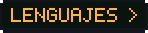
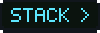
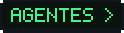

  <picture>
    <source media="(prefers-color-scheme: dark)" srcset="./assets/header-dark.svg">
    <source media="(prefers-color-scheme: light)" srcset="./assets/header-light.svg">
    
  </picture>

  <b>Product Engineer · Trujillo, Perú</b> 
  Programo orquestando agentes de IA en paralelo: uno coordina y los demás investigan, programan, revisan y prueban. 
  EN · Product Engineer from Trujillo, Peru. I build by orchestrating AI agents, not just prompts.

  
  

  <picture>
    <source media="(prefers-color-scheme: dark)" srcset="https://github-profile-summary-cards.vercel.app/api/cards/profile-details?username=JosueP0721&amp;theme=github_dark&amp;bg_color=07100b&amp;title_color=46f28c&amp;text_color=b8c7bd&amp;icon_color=ffb43c&amp;border_color=2b9d5d&amp;chart_color=46f28c">
    <source media="(prefers-color-scheme: light)" srcset="https://github-profile-summary-cards.vercel.app/api/cards/profile-details?username=JosueP0721&amp;theme=github&amp;bg_color=f4ecd6&amp;title_color=1a6b3c&amp;text_color=3d3a30&amp;icon_color=b5410f&amp;border_color=c2b79c&amp;chart_color=2e9e5b">
    
  </picture>

  <picture>
    <source media="(prefers-color-scheme: dark)" srcset="https://streak-stats.demolab.com/?user=JosueP0721&amp;background=07100b&amp;border=2b9d5d&amp;stroke=2b9d5d&amp;ring=46f28c&amp;fire=ffb43c&amp;currStreakNum=46f28c&amp;sideNums=46f28c&amp;currStreakLabel=ffb43c&amp;sideLabels=b8c7bd&amp;dates=6f8f7a&amp;locale=es&amp;disable_animations=true">
    <source media="(prefers-color-scheme: light)" srcset="https://streak-stats.demolab.com/?user=JosueP0721&amp;background=f4ecd6&amp;border=c2b79c&amp;stroke=c2b79c&amp;ring=1a6b3c&amp;fire=b5410f&amp;currStreakNum=1a6b3c&amp;sideNums=1a6b3c&amp;currStreakLabel=b5410f&amp;sideLabels=3d3a30&amp;dates=6f6650&amp;locale=es&amp;disable_animations=true">
    
  </picture>

  <picture>
    <source media="(prefers-color-scheme: dark)" srcset="https://raw.githubusercontent.com/JosueP0721/JosueP0721/output/snake-dark.svg">
    <source media="(prefers-color-scheme: light)" srcset="https://raw.githubusercontent.com/JosueP0721/JosueP0721/output/snake-light.svg">
    
  </picture>

<!--ACTIVIDAD:START-->
Sin actividad pública reciente: casi todo mi código vive en repos privados.
<!--ACTIVIDAD:END-->

  
  
  
  

  
  
  
  
  
  
  
  
  
  

  
  
  
  
  
  

